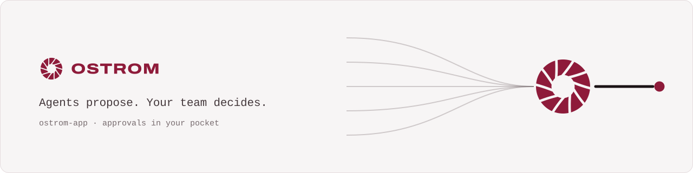
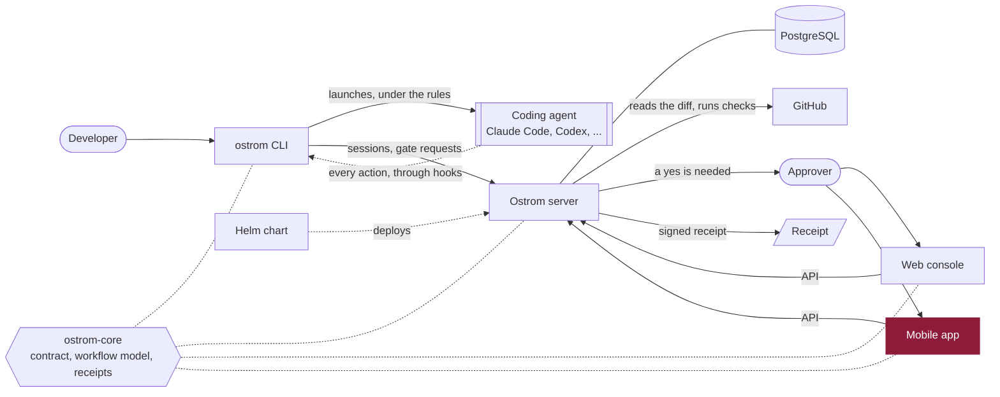

<p align="center">
  <a href="https://ostrom.run">
    <picture>
      <source media="(prefers-color-scheme: dark)" srcset=".github/assets/banner-dark.svg">
      
    </picture>
  </a>
</p>

<p align="center">
  <strong>Ostrom runs a company's AI coding agents in the cloud and makes them follow the team's rules.</strong><br>
  Every change they make leaves a receipt, and the few that matter wait for a person's yes.
</p>

<p align="center">
  <a href="https://ostrom.run">Website</a> ·
  <a href="https://ostrom.run/docs">Docs</a> ·
  <a href="https://github.com/ostrom-hq/ostrom-app/discussions">Discussions</a> ·
  <a href="CONTRIBUTING.md">Contributing</a> ·
  <a href="SECURITY.md">Security</a>
</p>

<p align="center">
  <a href="https://github.com/ostrom-hq/ostrom-app/actions/workflows/ci.yml"></a>
  <a href="CONTRIBUTING.md#tests-the-bar"></a>
  <a href="LICENSE"></a>
  <a href="CHANGELOG.md"></a>
</p>

## What this is

The phone is where a person says yes. A push notification says a request is waiting; the app shows its evidence
(commits, repository, checks, who asked), and the yes or the no is given behind Face ID or the device biometrics. It
also verifies signed receipts offline, on the phone, and will show the history, the agents' activity and the
spending map. React Native with Expo and expo-router, TypeScript at its strictest.

## Quick start

```sh
git clone https://github.com/ostrom-hq/ostrom-app.git && cd ostrom-app
npm ci
npm start          # Expo dev server: press i for iOS, a for Android
```

## How it fits



## Status

Ostrom is before its first public release, and the app is not in the stores yet.

| Part | Status |
| --- | --- |
| Offline verification of signed receipts (Ed25519, canonical JSON) | Available |
| Typed HTTP client, repositories, mocks of the API | Available |
| Approval inbox, push notifications, biometric yes or no | In progress |
| History, agent activity, spending map | Planned |

## Development

```sh
npm run check      # typecheck + lint + tests, what CI runs
npm run test:ci    # tests with the 100 % coverage gate
```

## End-to-end tests

Maestro flows in [`.maestro/`](.maestro), run by the `E2E` workflow on an Android emulator against the release build
(about 30 minutes: on `main`, by hand, and on a pull request labelled `full-ci`). No Ostrom server runs on the runner:
the E2E build (`EXPO_PUBLIC_OSTROM_MOCK=1`) answers from the in-memory server of `src/api/mocks/mockServer.ts`, the
same one the unit tests use, through the real HTTP client, repositories and screens. Only the GitHub sign-in, the
fingerprint and push are replaced, since the emulator has none of them. `metro.config.js` swaps the services only for
that build, and the `ci` job proves it: `scripts/check-store-bundle.sh` first exports the E2E bundles and requires the
mock's strings in both (Android, iOS), so that the search is known to see them, then exports the production bundles as
a store build makes them and fails on any trace of the mock on either platform. `scripts/run-maestro.sh` runs the flows
one at a time once the emulator answers (with an `adb reconnect` when it does not), after a warm-up flow that does not
count (`.maestro/common/warm-up.yaml`). A flow runs a second time only when its first failure is an outage of the
emulator (device offline, `DeviceServerDiedException`), never on a failed assertion.

| Flow | What it proves | Status |
| --- | --- | --- |
| `login.yaml` | Signed out on a new phone: the login screen, and an address that is not `https://` is refused before anything is sent | Green ([run 41048146402](https://github.com/ostrom-hq/ostrom-app/actions/runs/41048146402)) |
| `step-up.yaml` | A yes the server answers with 403 `step_up_required` (production deploy): the explanation, no raw error, then a button that opens the console on this request (when the console cannot open, its address to select and copy: unit tests) | Green ([run 41048146402](https://github.com/ostrom-hq/ostrom-app/actions/runs/41048146402)) |
| `self-approval.yaml` | A request the person asked for (`canApprove: false`, `self_approval_refused`): Approve is not offered, and the no still goes through with its reason | Green ([run 41048146402](https://github.com/ostrom-hq/ostrom-app/actions/runs/41048146402)) |
| Organization required | A member of several organizations without `Ostrom-Org` (409 `org_required`): the inbox and the request say it clearly and lead to Settings, where the person chooses among `GET /me/organizations`. The header is sent on every call and the mock server checks it like the real one (unit tests) | Missing |
| Approve a request | A yes on someone else's request is sent with the shown digest and the request shows as approved | Missing |
| Changed request | The request changes while it is shown (409 `shown_digest_mismatch`): the app asks to read it again | Missing |
| Organization isolation | Another organization's data never shows (CONVENTIONS.md section 16) | Missing: needs a second organization on a real server |
| Receipts, history, activity, spending | Each screen opens and reads its data | Missing |

Against the real server, the workflow `E2E real server` (`.github/workflows/e2e-real.yml`) starts the `edge` image of
ostrom-server with PostgreSQL, signs a new person in by e-mail, gives them an organization and a personal token
(`scripts/real-server-session.sh`), and builds the app with `EXPO_PUBLIC_OSTROM_REAL_E2E=1`: the real services, signed in
with that token (`src/config/realServices.ts`). It runs the flows of `.maestro/real/`. Until the image can be pulled from
this repository (Actions access of the package), they are skipped with a warning; the repository variable
`OSTROM_APP_REQUIRE_REAL_SERVER=true` makes a skip fail.

| Flow (real server) | What it proves | Status |
|---|---|---|
| `real/history.yaml` | Signed in on the real server: the History reads its receipts and keys (none yet), Settings shows the login | Skipped until the package access |

## Layout

| Path | What lives there |
|---|---|
| `src/app/` | expo-router routes, thin: each file renders a screen |
| `src/ui/screens/<feature>/` | a screen and its view-model hook (`use<Screen>ViewModel`) |
| `src/ui/components/` | shared UI pieces |
| `src/ui/theme/` | the Signal tokens (garnet `#8E1B3A`), light and dark |
| `src/config/` | i18n, query client, environment |
| `src/i18n/` | locales: English is the source, every other locale is type-checked against it |

## Rules

- TypeScript at its strictest (`exactOptionalPropertyTypes`, `noUncheckedIndexedAccess`…) and ESLint
  `strict-type-checked`; no `any`, no `eslint-disable` (inline config is off), no type assertion on data:
  anything that crosses a boundary (HTTP, storage, notification payload) is read by a zod schema.
- No hard-coded text: `t("…")` with keys checked by the compiler.
- Garnet means "a person is awaited or has just decided", and nothing else; amber is budget, red is error.

## Repositories

| Repository | What it is | License |
| --- | --- | --- |
| [ostrom-core](https://github.com/ostrom-hq/ostrom-core) | Shared Kotlin Multiplatform library: API contract, workflow model, signed receipts | Apache-2.0 |
| [ostrom-cli](https://github.com/ostrom-hq/ostrom-cli) | The `ostrom` command line: runs coding agents under the team's rules | Apache-2.0 |
| [ostrom-server](https://github.com/ostrom-hq/ostrom-server) | The server: gates, receipts, policies, the API | AGPL-3.0 + ee |
| [ostrom-web](https://github.com/ostrom-hq/ostrom-web) | The web console | AGPL-3.0 + ee |
| **ostrom-app** (this one) | The iOS and Android app | AGPL-3.0 + ee |
| [ostrom-e2e](https://github.com/ostrom-hq/ostrom-e2e) | Full-stack end-to-end and load tests | Apache-2.0 |
| [ostrom-site](https://github.com/ostrom-hq/ostrom-site) | ostrom.run: website, documentation, blog | Apache-2.0 |
| [ostrom-helm](https://github.com/ostrom-hq/ostrom-helm) | Helm chart and Docker Compose for self-hosting | AGPL-3.0 |

## Contributing

Contributions are welcome. Read [CONTRIBUTING.md](CONTRIBUTING.md) (setup, tests, Conventional Commits, DCO), the
[Code of Conduct](CODE_OF_CONDUCT.md), and [SECURITY.md](SECURITY.md) to report a vulnerability privately. Questions
go to [Discussions](https://github.com/ostrom-hq/ostrom-app/discussions); help options are in [SUPPORT.md](SUPPORT.md).

## License

GNU Affero General Public License v3.0 ([LICENSE](LICENSE)), except the `ee/` directory, under the Ostrom Enterprise License ([ee/LICENSE](ee/LICENSE)): you can read, modify and test that code, and running it in production needs an Ostrom Enterprise subscription. Details in [LICENSING.md](LICENSING.md).
