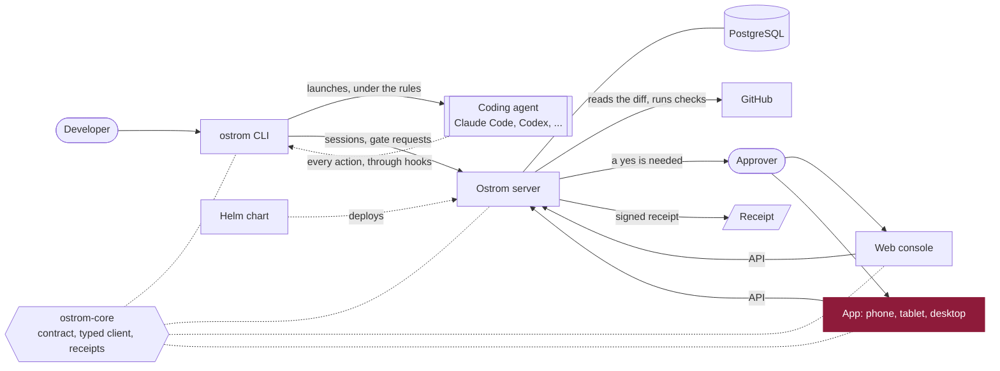

<p align="center">
  <a href="https://ostrom.run">
    <picture>
      <source media="(prefers-color-scheme: dark)" srcset=".github/assets/banner-dark.svg">
      
    </picture>
  </a>
</p>

<p align="center">
  <strong>Ostrom runs a company's AI coding agents in the cloud and makes them follow the team's rules.</strong><br>
  Every change they make leaves a receipt, and the few that matter wait for a person's yes.
</p>

<p align="center">
  <a href="https://ostrom.run">Website</a> ·
  <a href="https://ostrom.run/docs">Docs</a> ·
  <a href="https://github.com/ostrom-hq/ostrom-app/discussions">Discussions</a> ·
  <a href="CONTRIBUTING.md">Contributing</a> ·
  <a href="SECURITY.md">Security</a>
</p>

<p align="center">
  <a href="https://github.com/ostrom-hq/ostrom-app/actions/workflows/ci.yml"></a>
  <a href="CONTRIBUTING.md#tests-the-bar"></a>
  <a href="LICENSE"></a>
  <a href="CHANGELOG.md"></a>
</p>

## What this is

The app is where a person follows Ostrom and says yes: on iOS, iPad, Android, and the desktop on macOS, Linux and
Windows, one identical app whose layout adapts to the screen. A push says a request is waiting; the app shows its
evidence (commits, repository, checks, who asked), and the person answers. A yes from a phone requires a fresh unlock of
the app (Face ID or the device biometrics), bound to the request it answers: the server checks that unlock, never the
biometrics themselves. The app also verifies signed receipts on the device, and shows the waits, the history, the
agents' activity and the spending.

## Why Kotlin Multiplatform

The app was rewritten in Kotlin Multiplatform and Compose Multiplatform (2026-11-13), from a React Native (Expo) app.
The requirement: the team needs one identical app to reach its agents on iOS, iPad, Android **and the desktop on macOS,
Linux and Windows**, only the layout adapting to the screen, as with TeamCode's companion that it uses every day. The
technology was left open; Claude (the AI agent doing the port) chose Kotlin Multiplatform, for these reasons. React
Native with Expo has no desktop target that shares the phone's code; TeamCode's companion already does all of this in
Kotlin Multiplatform, and the rest of Ostrom (core, server, CLI) is Kotlin Multiplatform too, so the app shares the
contract's models and the typed client of ostrom-core with the CLI. Full reasoning and the options set aside:
[decision 0001](docs/decisions/0001-kotlin-multiplatform-companion.md).

## Quick start

Prerequisites: JDK 21, the Android SDK (platform 37) for the Android app, Xcode for the iOS app. ostrom-core is built
from a clone next to this one when there is one (`../ostrom-core`), else taken from GitHub Packages.

```sh
git clone https://github.com/ostrom-hq/ostrom-core.git
git clone https://github.com/ostrom-hq/ostrom-app.git && cd ostrom-app
./gradlew :companion-desktop:run                    # the desktop app
./gradlew :companion-android:installDebug           # the Android app, on a device or an emulator
open companion-ios/Ostrom.xcodeproj                 # the iOS app (Xcode builds the shared framework)
```

## How it fits



## Status

Ostrom is before its first public release, and the app is not in the stores: builds go to TestFlight and Play's internal
track only (see [Release](#release)). What the app does, screen by screen, and what remains:
[docs/companion.md](docs/companion.md).

| Part | Status |
| --- | --- |
| Sign-in (GitHub in the system browser on a phone, the device flow of `ostrom login` on a computer), several accounts and servers, secure storage, organization, capabilities check, light and dark, English and French, demo | Available |
| Approvals inbox and request (yes after a biometric unlock bound to the request), waits, history and receipt verification, activity, spending, push | Being ported from the React Native app |
| Artifacts and the other TeamCode features Ostrom serves, desktop menu bar and CLI account, Play and desktop distribution | Planned |

## Development

```sh
./gradlew :companion:jvmTest :companion:koverVerify   # domain and Compose UI tests on the desktop JVM, coverage gate
./gradlew :companion:testAndroidHostTest              # the same tests on Android's host JVM
./gradlew :companion-android:assembleDebug            # the Android app
```

CI runs these on every pull request, and compiles the iOS code; on `main` it also builds the iOS app for the simulator
and the desktop app on Linux, macOS and Windows, unsigned.

## Release

Store builds are made and uploaded from a maintainer's Mac with fastlane, exactly as TeamCode's companion: the same
`Gemfile` and `fastlane/Fastfile`, with Ostrom's identifiers (`run.ostrom.app` on both stores). There is no publication
job. Nothing in the repository holds a key, a certificate or a password: each lane reads them from files next to the
Fastfile and from the environment, all ignored by git.

```sh
bundle install
bundle exec fastlane ios beta version:0.2.0       # build, sign, then upload to TestFlight
bundle exec fastlane android beta version:0.2.0   # signed bundle, then Play's internal track
```

| Lane | Does | Needs (local only) |
| --- | --- | --- |
| `bundle exec fastlane ios beta version:X.Y.Z` | Archives `companion-ios/Ostrom.xcodeproj` (shared scheme `Ostrom`, Release) with automatic signing through the App Store Connect key (Xcode cloud signing, no certificate in the keychain), then uploads to TestFlight without submitting | `fastlane/api_key.json`, `fastlane/key.p8` |
| `bundle exec fastlane android beta version:X.Y.Z` | `:companion-android:bundleRelease --no-daemon`, signed with the upload key, then uploads to Play's internal track | `fastlane/play-key.json`, `fastlane/keystore.jks`, `SIGNING_STORE_PASSWORD`, `SIGNING_KEY_ALIAS`, `SIGNING_KEY_PASSWORD` |

Only builds are uploaded, and no lane submits for review or releases. Xcode's build phase runs Gradle with ostrom-core
checked out next to this repository (`../ostrom-core`). Details, versions and what stays to do:
[docs/distribution.md](docs/distribution.md).

## Layout

| Path | What lives there |
|---|---|
| `companion/` | The shared app (Kotlin Multiplatform, Compose Multiplatform): `domain/` (models, use cases, repository interfaces), `infrastructure/` (the typed client of ostrom-core, secure storage, settings), `presentation/` (screens, view models, theme), `demo/`, `di/` (Koin) |
| `companion-android/` | The Android app: activity, manifest, resources |
| `companion-ios/` | The Xcode project of the iOS app, which embeds the shared framework `Companion` |
| `companion-desktop/` | The desktop app (macOS, Windows, Linux) and its packaging |
| `docs/` | How the app works ([companion.md](docs/companion.md)), distribution, decisions |

## Rules

- Clean Architecture: the domain knows neither the HTTP client nor Compose; screens talk to view models, view models
  to use cases and repositories, which the platform modules implement.
- API models and calls come from ostrom-core (`run.ostrom:ostrom-api`, `run.ostrom:ostrom-client`): never a
  hand-written copy of the contract. A server feature shows only when the server announces it in `/capabilities`.
- No hard-coded text: `Res.string` keys, English and French, checked by `LocalizationTest`.
- Garnet means "a person is awaited or has just decided", and nothing else; amber is budget, red is error.

## Repositories

| Repository | What it is | License |
| --- | --- | --- |
| [ostrom-core](https://github.com/ostrom-hq/ostrom-core) | Shared Kotlin Multiplatform library: API contract, workflow model, signed receipts | Apache-2.0 |
| [ostrom-cli](https://github.com/ostrom-hq/ostrom-cli) | The `ostrom` command line: runs coding agents under the team's rules | Apache-2.0 |
| [ostrom-server](https://github.com/ostrom-hq/ostrom-server) | The server: gates, receipts, policies, the API | AGPL-3.0 + ee |
| [ostrom-web](https://github.com/ostrom-hq/ostrom-web) | The web console | AGPL-3.0 + ee |
| **ostrom-app** (this one) | The app: iOS, iPad, Android, macOS, Linux, Windows | AGPL-3.0 + ee |
| [ostrom-e2e](https://github.com/ostrom-hq/ostrom-e2e) | Full-stack end-to-end and load tests | Apache-2.0 |
| [ostrom-site](https://github.com/ostrom-hq/ostrom-site) | ostrom.run: website, documentation, blog | Apache-2.0 |
| [ostrom-helm](https://github.com/ostrom-hq/ostrom-helm) | Helm chart and Docker Compose for self-hosting | AGPL-3.0 |

## Contributing

Contributions are welcome. Read [CONTRIBUTING.md](CONTRIBUTING.md) (setup, tests, Conventional Commits, DCO), the
[Code of Conduct](CODE_OF_CONDUCT.md), and [SECURITY.md](SECURITY.md) to report a vulnerability privately. Questions
go to [Discussions](https://github.com/ostrom-hq/ostrom-app/discussions); help options are in [SUPPORT.md](SUPPORT.md).

## License

GNU Affero General Public License v3.0 ([LICENSE](LICENSE)), except the `ee/` directory, under the Ostrom Enterprise License ([ee/LICENSE](ee/LICENSE)), and code ported from TeamCode under Apache-2.0 ([NOTICE](NOTICE)): you can read, modify and test that code, and running it in production needs an Ostrom Enterprise subscription. Details in [LICENSING.md](LICENSING.md).
